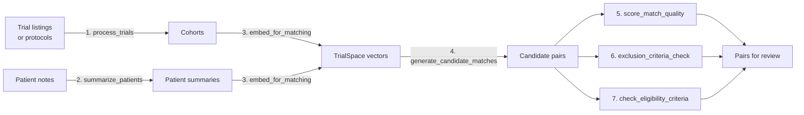

# How matching works

This page explains the ideas behind the matching workflow: what a cohort is, how criteria and patient summaries are
divided, what each of the seven steps does, and what the decision model's scores mean. The
[quickstart](../getting-started/quickstart.md) shows the code, and the
[example notebook](../getting-started/example-notebook.md) runs it on sample data.

MatchMiner-AI ranks and screens candidate pairs for human review. Its scores are not eligibility decisions: every
suggested match needs review by a clinician and the trial team against the complete, current protocol.

## Two directions

- **Patient-centric:** find the cohorts worth considering for a patient.
- **Trial-centric:** find the patients worth considering for a cohort.

Both directions use the same summaries, vectors and checks. Only retrieval changes: it returns the top-k cohorts
for each patient, or the top-k patients for each cohort.

## Cohorts

Trials are matched at the level of cohorts. A cohort is one population a trial enrolls with its own eligibility
criteria. A single-population trial has one cohort; a basket or umbrella trial can have many.

- **Equivalent cohorts are merged.** Extraction first lists every part, phase, arm or group the trial enrolls into.
  Groups whose criteria are equivalent then become one cohort, and `merged_from` records the originals. So
  randomized arms that enroll the same population are one cohort: only the treatment the trial assigns may differ.
  A required background or concurrent therapy, one the patient must already be receiving, is eligibility, so it
  keeps cohorts apart.
- **Names never narrow a population.** A cohort's name only identifies it. Its population comes from the document's
  criteria, and features the document gives only as examples ("solid tumors such as...") are not requirements.
- **Groups without their own criteria section are still cohorts**, for example parts implied by the numbering or
  regimens given to separate groups.

Each cohort has the identifier `cohort_trial_id`, `<trial_id>-cohort-<n>`.

## Key and boilerplate criteria

Every line of a cohort's criteria is tagged twice: inclusion or exclusion, and key or boilerplate.

- **Key criteria** define the population: cancer type, histology, extent of disease, prior treatment and
  biomarkers, along with age or sex when the trial restricts them. They are in `cohort_key_criteria`.
- **Boilerplate criteria** are the general requirements most trials share, such as performance status, organ
  function, brain metastases and other cancers. They are in `cohort_boilerplate_criteria`.
- **Every line with its tags** is in `cohort_criteria_items`, which the line-by-line check reads.

Retrieval and the match questions read only the key criteria, so cohorts are compared on the population they target
rather than on text that nearly every trial shares.

## Patient summaries

`summarize_patients` reads each patient's notes in date order. Repeated sentences are removed, the record is split
into overlapping chunks, and each chunk updates the running summary written from the earlier ones. There is no note
selection or retrieval step: every note is read. The summary has two sections that mirror the criteria:

- `cancer_history_summary`, the key section: diagnoses, histology, stage and extent, biomarkers and treatments;
- `general_exclusion_criteria_evidence`: the other history that boilerplate criteria ask about.

`patient_summary` holds both sections. When new notes arrive, an existing summary can be updated from the new notes
only (see [patients](../api/patients.md#updating-existing-summaries)).

## The seven steps

| Step | Function | Model | Output |
| --- | --- | --- | --- |
| 1. Trials to cohorts | `trials.process_trials` | LLM | One row per cohort with its complete, key and boilerplate criteria and tagged lines |
| 2. Notes to summaries | `patients.summarize_patients` | LLM | One row per patient with the two summary sections |
| 3. Embed | `embedding.embed_for_matching` | TrialSpace | One vector per patient (cancer history) and per cohort (key criteria) |
| 4. Retrieve | `matching.generate_candidate_matches` | none | The top-k pairs by cosine similarity, with `similarity_score` and `rank` |
| 5. Match quality | `matching.score_match_quality` | decision model | `match_quality_score` and `match_quality_pass` per pair |
| 6. Boilerplate | `matching.exclusion_criteria_check` | decision model | `exclusion_criteria_pass` per pair |
| 7. Line by line | `matching.check_eligibility_criteria` | decision model | One row per criteria line with `criterion_clearly_fails` |

Step 1 screens each trial for cancer treatment first; trials that are not cancer treatment trials produce no cohorts,
and the decisions are kept in the run's metadata. Its parts (`extract_cohorts` or `extract_protocol_cohorts`,
`merge_equivalent_cohorts`, `remove_boilerplate_criteria`) are also public functions, so a caller can run some and
skip others; see [trials](../api/trials.md).

Steps 5-7 are independent checks of the same pairs. A typical review keeps the pairs that pass step 5, then reads
steps 6 and 7 as flags.

## The decision model's questions

The decision model, [`LiquidAI/d1-2B`](https://huggingface.co/LiquidAI/d1-2B) or a checkpoint fine-tuned from it by
the [training pipeline](../training/index.md), answers yes/no questions about a pair in one forward pass. Each answer
is reported as P(yes).

| Question | Asked by | Reads | Yes means |
| --- | --- | --- | --- |
| Reasonableness | `score_match_quality` | cancer history, key criteria | The patient is potentially eligible; no means clearly ineligible |
| Cancer type, disease burden, treatment history, biomarkers | `score_match_quality` | cancer history, key criteria | The cohort specifically requires that dimension and the patient documentedly meets it |
| Boilerplate | `exclusion_criteria_check` | other history, boilerplate criteria | The patient does not clearly fail any boilerplate criterion |
| Per criterion | `check_eligibility_criteria` | both summary sections, one criteria line | The patient does not clearly fail the line; no means an inclusion line clearly not met or an exclusion line clearly met |

"Clearly" matters: missing information is not a failure. A patient whose record says nothing about a criterion is
left for the reviewer, not screened out.

## Scores and cutoffs

- **`match_quality_score`** ranks pairs from 0 to 1. It is the expected match score, P(reasonable) x (1 +
  P(cancer type) + P(burden) + P(treatment history) + 2 P(biomarker)) / 6, so a pair ranks higher when the patient
  is potentially eligible and the cohort is specific about the dimensions the patient matches.
- **`match_quality_pass`** is true when P(reasonable) is at least `match_quality.reasonableness_cutoff` (0.5). It is
  the model's own potentially-eligible call; the score is for ranking only.
- **`exclusion_criteria_pass`** is true when the boilerplate P(yes) is at least `exclusion_criteria.pass_cutoff`
  (0.5).
- **`criterion_clearly_fails`** is true when a line's P(yes) is below `criteria_check.fail_cutoff` (0.5).

`score_match_quality` returns only passing pairs unless `filter_low_quality=False`, and `check_eligibility_criteria`
can return only failing lines (`filter_failing=True`). Outputs are derived tables keyed on `patient_id` and
`cohort_trial_id`; merge them back onto the pairs.

The default decision model is the zero-shot base model. Treat its scores as provisional until it is replaced by a
fine-tuned checkpoint (`decision_model.model_name`) evaluated for your setting.

## LLM versions of the checks

`score_match_quality_with_llm`, `exclusion_criteria_check_with_llm` and `check_eligibility_criteria_with_llm` ask an
LLM the same questions and return a reason with each answer. The match and per-criterion versions use the prompts
the training pipeline's teacher uses to label pairs. They are slower and send both texts to the configured endpoint,
so use them where a written reason helps the reviewer and the endpoint is approved for the data.

## Models

- **LLM.** Steps 1 and 2 use `nvidia/NVIDIA-Nemotron-3.5-Super-VL-120B-A12B-NVFP4` by default, in-process with vLLM
  or on an OpenAI-compatible server. See [choosing an inference setup](local-vs-remote.md) and
  [LLM runtime](../reference/llm-runtime.md).
- **TrialSpace.** A sentence-embedding model fine-tuned from `google/embeddinggemma-2` by the training pipeline. The
  default preset names a local checkpoint that is not published, so set `embedding.model_path` to your own. Vectors
  from different TrialSpace models are not comparable: re-embed both sides after changing the model.
- **Decision model.** Runs in-process on a GPU with Transformers.

The published models and synthetic datasets are on [Hugging Face](https://huggingface.co/ksg-dfci). The latest
release, [collection 0526](https://huggingface.co/collections/ksg-dfci/matchminer-ai-0526), comes from the earlier
trial-space pipeline: its ModernBERT checkers are not used by this package, and its TrialSpace model was trained on
a different text format than cohort key criteria.

## Guideline populations

The same retrieval and match questions can run against guideline catalogs instead of trials. A catalog built from
NCCN or NCI PDQ guidelines describes populations ("spaces", identified by `space_trial_id`) with cohort-style key
criteria, and `matching.retrieve_guideline_considerations` finds the ones that fit a patient. See
[guideline extraction](guideline-extraction.md) and [PDQ catalogs](pdq-catalogs.md).
